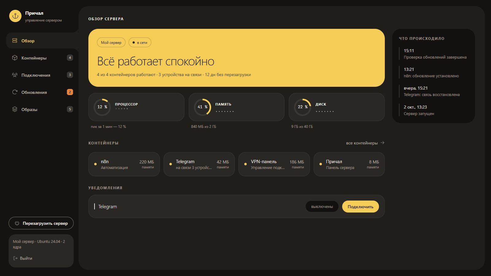
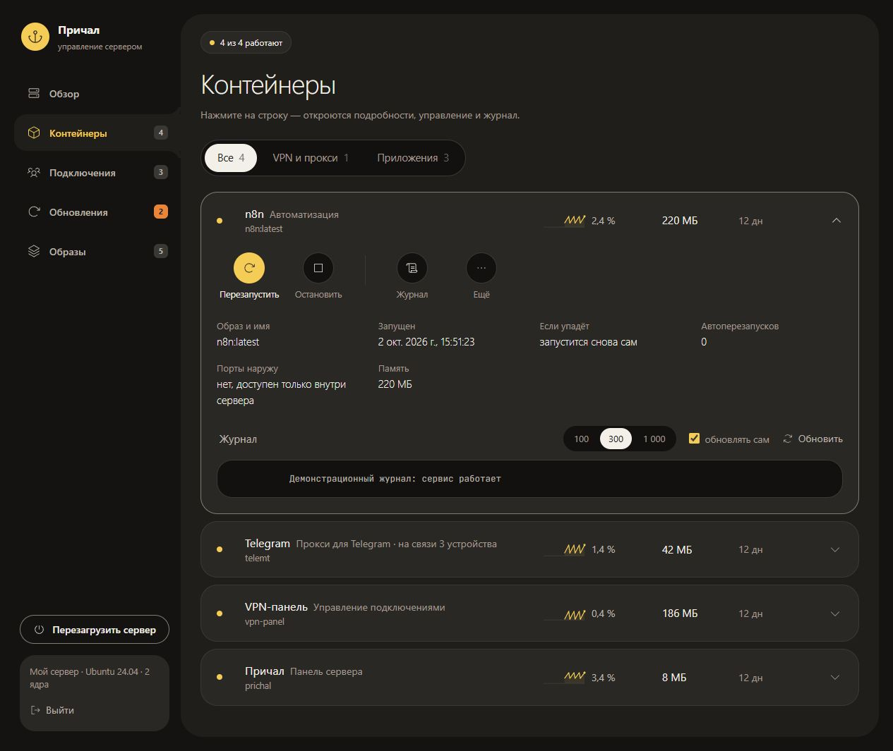

# Причал

[](https://github.com/aeyota93-cloud/prichal/actions/workflows/ci.yml)
[](LICENSE)

Причал — панель для своего Linux-сервера. Открываете её в браузере и видите,
что работает, сколько осталось памяти и места, какие есть обновления.
Если программа зависла, её можно перезапустить; если упала — посмотреть журнал.
Всё на русском.

Панель работает с Docker. Контейнер — это запущенная в Docker программа,
например n8n или VPN. Причал управляет тем, что уже установлено на сервере:
сам VPN он не устанавливает и новых пользователей VPN не создаёт.

## Как это выглядит

На главной — состояние сервера, нагрузка и последние события.
Данные на скриншотах демонстрационные.



У каждого контейнера есть кнопки управления и журнал. Перед остановкой
Причал спросит подтверждение и объяснит, что перестанет работать.

<details>
<summary>Посмотреть контейнер и журнал</summary>



</details>

[На телефоне интерфейс тоже помещается на экран](docs/screenshots/mobile.jpg).

## Что можно делать

| Раздел | Для чего |
|---|---|
| Обзор | Проверить процессор, память, диск и последние события; подключить Telegram-уведомления. |
| Контейнеры | Запустить, остановить или перезапустить программу, посмотреть её нагрузку и журнал. |
| Подключения | Посмотреть клиентов поддерживаемых контейнеров Amnezia: AmneziaWG, WireGuard, OpenVPN и Telegram-прокси telemt. Раздел появляется, когда такие контейнеры есть. |
| Обновления | Установить выбранные пакеты Linux, обновить приложения Docker Compose и сам Причал. |
| Образы | Удалить ненужные образы Docker и кэш сборки, чтобы освободить место. Данные приложений эта очистка не удаляет. |

Для пакетов системы поддерживаются apt, dnf, yum и apk. Приложения,
запущенные без Docker Compose, обновляются вручную — панель об этом скажет.
Счётчики подключений рассчитаны на контейнеры Amnezia с именами
`amnezia-*`; произвольный VPN или панель вроде PasarGuard сюда не входят.

## Перед установкой

Нужны Linux-сервер, его адрес и доступ по SSH. SSH — это вход на сервер
через терминал. Адрес и данные для входа обычно выдаёт хостинг.

На сервере должны быть Docker Engine, плагин Docker Compose v2, git и
curl или wget. Инструкция ниже рассчитана на обычный Docker с правами root
и процессор amd64 или arm64. Для сборки удобнее иметь хотя бы 1 ГБ памяти;
на небольшом сервере может понадобиться подкачка.

Причал получает доступ к Docker и может управлять всем сервером. Ставьте
его на сервер, которым распоряжаетесь сами. По умолчанию панель не открыта
в интернет: вы будете заходить через защищённое SSH-соединение.

## Установка

### 1. Войдите на сервер

На **своём компьютере** откройте терминал. В Windows подойдёт PowerShell.
Вместо `АДРЕС-СЕРВЕРА` ниже везде подставьте IP своего сервера:

```sh
ssh root@АДРЕС-СЕРВЕРА
```

Если хостинг выдал другое имя пользователя, замените `root` на него
в этой команде и в команде туннеля ниже.

Введите пароль сервера. Символы при вводе не видны — это нормально.
Если у вас вход по ключу, SSH может попросить парольную фразу ключа.
После входа команды в этом окне выполняются уже **на сервере**.

Если входите не как root, выполните `sudo -i`. Для установки нужны права root.

### 2. Проверьте Docker и git

В том же окне, **на сервере**, выполните:

```sh
docker --version
docker compose version
git --version
```

Если команды показывают версии, переходите дальше. Если Docker или Compose
не установлены, используйте официальную инструкцию для вашей системы:
[Ubuntu](https://docs.docker.com/engine/install/ubuntu/),
[Debian](https://docs.docker.com/engine/install/debian/) или
[другой Linux](https://docs.docker.com/engine/install/).
На сервере с уже работающим Docker заново устанавливать его не нужно.

Если на Ubuntu или Debian нет git или curl:

```sh
apt-get update
apt-get install -y git curl
```

### 3. Скачайте и запустите Причал

Выполните **на сервере**:

```sh
git clone https://github.com/aeyota93-cloud/prichal.git /opt/prichal
cd /opt/prichal
./install.sh
```

Установка соберёт панель, запустит её и проверит ответ. Это может занять
несколько минут. Файл настроек `.env` создаётся автоматически.

В конце должна появиться строка:

```text
=== Причал работает на 127.0.0.1:9443 ===
```

Если вместо неё ошибка, посмотрите [подсказки ниже](#если-не-получилось).

### 4. Откройте панель

Теперь откройте **второе окно терминала на своём компьютере** и выполните:

```sh
ssh -N -L 127.0.0.1:9443:127.0.0.1:9443 -o ExitOnForwardFailure=yes root@АДРЕС-СЕРВЕРА
```

Это SSH-туннель: он соединяет порт на вашем компьютере с панелью на сервере.
После ввода пароля окно обычно ничего не пишет. Оставьте его открытым
и зайдите в браузере на **[http://localhost:9443](http://localhost:9443)**.
Порт 9443 открывать в настройках хостинга или файрвола не нужно.

При первом входе придумайте пароль панели — не короче восьми символов —
и введите его дважды. Это отдельный пароль, не пароль SSH.
После входа откроется обзор вашего сервера. Вход запоминается на 30 дней.

Закроете окно туннеля — панель станет недоступна. Сам сервер и его программы
продолжат работать. В следующий раз достаточно снова запустить туннель.

## Чтобы не вводить команду каждый раз

Для Windows есть готовый [файл запуска](https://raw.githubusercontent.com/aeyota93-cloud/prichal/main/clients/prichal-tunnel.cmd).
Сохраните его как `prichal-tunnel.cmd`, откройте в Блокноте и замените
`АДРЕС-СЕРВЕРА` в строке `set "SERVER=root@АДРЕС-СЕРВЕРА"`.
Двойной щелчок запустит туннель, а браузер откроется после подключения.
Чёрное окно оставляйте открытым, пока работаете с панелью.

Для macOS и Linux — [скрипт запуска](clients/prichal-tunnel.sh).
Скачайте его и выполните на своём компьютере:

```sh
chmod +x prichal-tunnel.sh
./prichal-tunnel.sh root@АДРЕС-СЕРВЕРА
```

## Уведомления в Telegram

Подключать их необязательно. Без бота панель работает и ведёт ленту событий.

1. Проверьте, что в настройках Telegram у вас есть имя пользователя `@username`.
2. У [@BotFather](https://t.me/BotFather) отправьте `/newbot`, задайте название
   и имя бота. В ответ получите токен — сохраните его и никому не пересылайте.
3. В Причале откройте **Обзор → Telegram → Подключить**. Вставьте токен
   и своё имя пользователя.
4. Откройте созданного бота и нажмите **Start**. Дождитесь приветствия.

Бот напишет, если контейнер упал, сервер перезагрузился или заканчиваются
память и место. По воскресеньям в 12:00 присылает сводку обновлений;
по умолчанию время московское. Из панели можно отправить проверочное сообщение
или отключить уведомления.

## Как обновить

Откройте **Обновления → Проверить обновления**. Чтобы обновить сам Причал,
найдите его в блоке **Приложения**, нажмите **Обновить** и подтвердите.
Панель скачает код, пересоберётся и ненадолго пропадёт. Настройки и пароль
сохранятся. Если новая версия не запустится, скрипт попытается вернуть прежнюю.

Пакеты Linux и другие приложения обновляются в том же разделе. Docker
заранее не отмечен: его обновление может прервать работу всех контейнеров.
Перед обновлением приложения проверьте галочку **«копия данных»**.
Она относится к томам Docker, а не ко всем файлам на сервере.

Если панель не открывается, обновить Причал можно **на сервере**:

```sh
cd /opt/prichal
git pull --ff-only
./install.sh
```

## Если не получилось

| Что видите | Что сделать |
|---|---|
| `./install.sh: Permission denied` | В папке `/opt/prichal` запустите `sh install.sh`. |
| Сборка заканчивается словами `killed` | Вероятно, не хватает памяти. Добавьте подкачку или свободную память и повторите установку. |
| В браузере «Не удаётся получить доступ» | Проверьте, что окно туннеля открыто, а адрес — `http://localhost:9443`. На сервере посмотрите `docker logs --tail 30 prichal`. |
| `Address already in use` | Порт занят. Возможно, туннель уже открыт в другом окне. [Как выбрать другой порт](docs/administration.md#другой-порт-туннеля). |
| Бот молчит | Откройте настройки Telegram в панели. Проверьте своё имя пользователя и нажмите Start у бота. |
| Забыли пароль панели | [Как сбросить пароль](docs/administration.md#сброс-пароля). |

## Остальные инструкции

- [Настройки, доступ по домену и восстановление данных](docs/administration.md).
- [Как устроена защита и какие права получает панель](docs/administration.md#безопасность).
- [Запуск для разработки и проверки кода](docs/development.md).

Нашли ошибку — [создайте Issue](https://github.com/aeyota93-cloud/prichal/issues):
что сделали, чего ожидали и что получилось. Пароли, токены и ссылки VPN
с секретами в сообщения и скриншоты не добавляйте.

## Лицензия

MIT. Файлы шрифтов Onest и JetBrains Mono — SIL Open Font License 1.1,
значки Phosphor — MIT.
