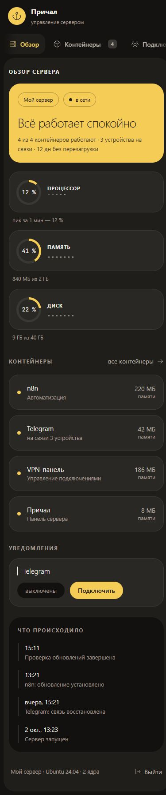

# Причал — новый дизайн

Причал получил оформление в одном стиле со «Шлюпкой спасения»:

- тёплая тёмная палитра, жёлтые акценты и системный шрифт Segoe UI;
- боковое меню в виде закладок и округлые карточки;
- кольцевые показатели процессора, памяти и диска;
- единый вид всех разделов и страницы входа;
- адаптация для телефона;
- сборка на Go 1.26.9 с исправлениями безопасности стандартной библиотеки.

Серверная логика, обработчики действий и подтверждения опасных операций
сохранены. Для обновления: **Обновления → Проверить обновления → Приложения →
Причал → Обновить**. Панель сама скачает код, пересоберётся и перезапустится.

Скриншоты сделаны с демонстрационными данными.

## Компьютер


## Телефон



## Проверки

`go test ./...`, `go vet ./...` и сборка Linux amd64 прошли.
Все пять разделов проверены в браузере на ширинах 320, 820, 1024, 1280 и
1600 px. Проверены раскрытие контейнера, журнал, предупреждение об остановке
прокси и его отмена; вход проверен на ширине 390 px.

## Локальный предпросмотр

```sh
node scripts/preview.cjs
```

Открыть `http://127.0.0.1:19444`; `/mobile` показывает страницу в рамке шириной
390 px, `/login.html` — вход. Данные демонстрационные. Предпросмотр слушает
только loopback и блокирует действия с сервером. Остановить его можно Ctrl+C.
